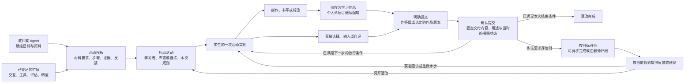

# 学习平台内核参考架构

学习目标说明学生要学会什么。活动实例把目标、材料和练法绑定到某个学生的某一次学习。**学习作品是学生产出的、可以独立保存并按版本引用的内容。** 平台通过提交把选定的作品版本纳入学习活动，作为步骤证据或正式作答。

同一个内核既能接收两行证明的固定片段，也能接收一道自评题的选择。个人开发首版交付这个可复用的内核模块，以在线两步阅读作为第一个使用它的练法。

## 第 0 章 · 先认清内核的边界

| 词       | 在这个平台里是什么意思                                                  |
| ------- | ------------------------------------------------------------ |
| **内核**  | 所有学习应用共同依赖的一组规则。它管理身份与版本、活动状态、作品与提交、证据归属、权限和扩展契约，使不同的人写出的练法能够一起工作。 |
| **扩展**  | 可独立作者化、校验、安装和分享的能力。例如一种标注交互、一套阅读方法、一种评分量表或一个诊断视图。            |
| **应用**  | 面向用户的完整产品。备课工作台、背词应用、数学分步训练器都可以使用同一个内核，各自决定界面和教学体验。          |
| **契约**  | 模块对输入、输出和行为的承诺。例如“提交这一步”必须说清收什么证据、何时算成功、重复提交会怎样，以及失败后如何恢复。   |
| **声明式** | 作者描述需要的材料、步骤、证据和规则，由平台解释执行。普通模型可以用声明创造新练法，平台也能在学生使用前检查它。     |

**作者线**从目标和材料形成练法模板。**学习线**从一次布置或自练启动，按这次活动的规则收取证据、评估并公布反馈。



### 哪些能力是必需的

| 职责归属 | 由它决定什么 | 换一种练法时 |
|---|---|---|
| 内核 | 启动实例并固定版本，按声明放行步骤或结束活动。确认提交时固定作答值或作品片段、记录证据来源。重发返回同一回执，中断恢复同一尝试。按策略维护有效判定，每次交付按当前授权裁决。 | 题目、步骤和槽位的标识用来定位声明和记录。收一组引文或收一次自评，都走同一条提交路径。 |
| 练法模板与布置 | 作者选择目标、材料、步骤顺序、工具、证据槽位和观察单位，规定何时结束、如何评估、何时揭晓。布置者在模板允许的范围内选用具体策略。 | 更改题数、轮次、时限或盲批条件，发布新的模板或布置。进行中的实例沿用已固定的教学版本。 |
| 工具与评估器 | 工具解释输入，产出约定类型的作答或作品。服务端评估器解释答案键或量表，返回对指定单位和目标的判定。 | 选区工具知道怎样定位原文，选择题评估器知道怎样核对选项。需要听写、录音等新能力时，可独立接入相应工具。 |
| 宿主应用 | 展示材料，处理输入、草稿回显、页面导航与错误恢复。根据获准的状态和字段呈现结果。 | 同一提交可从题卡或全屏工作区发起。切换页面仍可恢复到原记录，打开复盘页也要经过服务端授权。 |

只有当现有契约无法表达一条跨练法必须共同遵守的规则时，才扩充内核，同时说明适用范围、旧实例的恢复行为和可重复的验收例。

### 个人开发首版的交付范围

首版采用一个在线宿主、一个服务进程和一个独立的 SQLite 数据库。内核作为服务中的独立模块，读取带版本的练法声明，按能力调用内置工具和评估器。各章描述的职责可部署在同一进程。

1. **作者能发布可运行的练法。** 发布入口和运行时共用契约定义，为首批内置能力校验版本、输入输出类型、槽位引用与权限。缺少必需引用时指出具体步骤和字段，修正后可重新预演。只读组件按其声明的能力校验。[首版实施清单](学习平台内核首版实施清单.md)
2. **师生能完成并恢复一次活动。** 宿主即时回显输入。服务端在同一事务中记下确认、进度和本次声明要求的待评工作，重启后可从库内继续。学生先取得可靠回执，只有依赖判定的步骤或反馈才等待评估。改判保留历史，读取回执、作品和成绩时复核当前权限。小规模整篇成绩直接由有效判定算出。
3. **换练法能走通同一入口。** 用在线两步阅读验收双端交卷、重启、连续改判和撤权。再只替换声明，用同一材料跑一次“只交选据即完成”，应能取回回执，评估任务为零。两份模板都走同一组启动、提交、恢复与读取入口。[在线两步阅读实施规格](在线两步阅读实施规格.md)

### 哪些能力可以后置

| 能力 | 何时值得投入 |
|---|---|
| 离线交卷、跨设备草稿同步、原生宿主 | 有练法确实需要断网作答或接续编辑时，再实现离线授权、重连去重与草稿冲突处理。首版已覆盖两个在线窗口竞争同一次交付。 |
| 第三方扩展安装、沙箱、跨模板变更影响报告和自动迁移 | 需要执行外部代码时先补隔离与合规验证。多份模板共享组件、人工核对升级影响开始困难时，再建设影响报告和迁移工具。历史提交从首版起即可按原版本回看。 |
| 报表预计算、后台重建、掌握度模型和 Agent 检索 | 先按实际查询建立索引并测量首屏耗时。有重复慢查询时再预计算相应报表，有明确消费者时再引入模型或检索。十万条事件是容量验证样例，首版从实际负载起测。 |

### 网站与独立应用怎样共用内核

网页、WebView 和原生应用交换带版本的活动定义、组件树、作品引用与指令结果。宿主提供显示、输入、文件、网络、时钟、身份和本机保存。组件声明支持的平台、所需能力、可访问名称与状态反馈。WebView 可复用网页组件，原生界面可自行实现绘制和布局。两端运行同一份行为样例应产生相同的学习事实。离线宿主还须具备活动声明的本地内容、运行能力与授权。[Windows WebView2](https://learn.microsoft.com/en-us/microsoft-edge/webview2/) · [Android WebView](https://developer.android.com/develop/ui/views/layout/webapps/webview)

## 第一部分 · 学的是什么

| 章     | 模块            | 它负责的决定                                                                                    |
| ----- | ------------- | ----------------------------------------------------------------------------------------- |
| **1** | **学习对象与资源**   | 题目、词条、案例、文章、音频可以独立存在，有身份、版本、来源和具名字段。对象类型声明它能提供什么材料。一个词条可提供词形、读音、释义和例句，供多种练法引用。            |
| **2** | **学习目标与知识体系** | 区分“学什么主题”和“要做到什么”。“导数”可以是主题，“能解释某点导数的几何意义”才是可观察的目标。目标可以关联知识组件、先修关系和成功标准，诊断才知道一次表现能说明哪种能力。 |
| **3** | **内容编排**      | 通过引用、顺序、分组和嵌套，把对象编成讲义、试卷、题库、单词本或专题。每次引用都有自己的位置身份，因此同一篇材料可以出现在不同课程中，分别附带不同任务。              |

**文档编排管材料放在哪里，教学流程管学生接下来做什么。** 一份讲义可以先通读，也可以配上逐段提问的练法。共享材料保有自己的身份和版本。学生的圈画另存为学习作品，记录它附着的材料版本和使用位置。同一阅读活动可以让多道题共用一份材料圈画，各步骤可以提交与本步有关的片段。

可查的参照分别是 Anki 的一份笔记派生多种卡片、CASE 的能力目标引用、Common Cartridge 的资源组织与交换。[Anki Notes 与 Card Types](https://docs.ankiweb.net/manual/getting-started) · [1EdTech CASE](https://www.1edtech.org/standards/case) · [1EdTech Common Cartridge](https://www.1edtech.org/standards/cc)

## 第二部分 · 怎么呈现，学生能做什么

| 章     | 模块           | 它负责的决定                                                                                  |
| ----- | ------------ | --------------------------------------------------------------------------------------- |
| **4** | **渲染与交互组件** | 声明能展示什么材料、接受什么输入、产出何种作品或作答值，以及如何回看。能圈画的组件要提供可定位的材料表面或对象。 |
| **5** | **受控 UI 原语** | 提供展示、选择、输入、排序、连线、标注和提交等可组合的动作。通用书写工具负责笔刷、橡皮、撤销、缩放与续写。 |
| **6** | **学科工具** | 几何画板、音频录制、模拟实验、代码运行器通过工具契约加入。工具声明所需输入、权限、产出的作品类型和恢复方式。内核用相同的作品与提交规则接收它们。 |

### 工具展示、工作区与组件嵌套

原语提供现成动作，复杂工具可带自己的工作区。工具声明可用布局、输入设备和只读表示，宿主选择行内、分栏或全屏展示。切换布局沿用同一实例、草稿和焦点。教师可以直接打开几何画板演示，学生也可以另存一幅个人构图。

**组合单位是一个有身份的组件实例。** 容器声明具名子位置（槽位）、接收的组件类型、数量及顺序。例如“阅读工作区”左栏容纳文章与行内公式，右栏容纳三张题卡，每张题卡又有输入和证据槽。一个公式块可在同篇文章引用两次，两处共享内容版本，各自的选中、展开和编辑状态由各自的实例标识定位。作者工具检查必需槽位、父子关系、循环展开及宿主的深度与资源预算，报错指向具体嵌套位置。

子组件只取得该位置获准的材料，父活动按完成条件引用子提交。互动视频在指定时点暂停并打开子题，恢复时回到原时点、子题和草稿。拖回该时点可回看已有提交，显式重做才开新尝试。可选工具失效时显示当前角色可读的静态表示。必需工具失效时保稿，等待恢复或转入模板认可的替代路径。

组件升级要分别检查旧声明能否读取、作品能否按原样回看、评分含义有无变化。槽位重命名或拆分应提供有版本的转换和旧父子树样例。单选升级为多选时，应另发响应类型与评分规则。发布时可查[变更影响报告](#作者怎样看到组件与文档变更的影响)。

### 草稿纸、自由圈画与结构化标注

| 交互 | 产出的作品 | 如何用于学习 |
|---|---|---|
| **草稿纸** | 以独立纸面为坐标基准的手写稿或绘图。 | 可供学生自由演算，也可在练法要求时提交某一版推导。同一纸面工具还可直接用作正式手写的作答区。 |
| **自由圈画** | 附着在某个材料版本及其书写表面上的笔迹。 | 用于勾画、箭头和边注。回看时按落笔时的表面与坐标重现，保留学生实际看到的上下文。 |
| **结构化标注** | 指向特定材料版本的文本范围、对象或区域，可加上“论点”“依据”等标签。 | 适合要求学生明确指出原文证据、识别图形元素或进行自动核对的步骤。 |

自由圈画要保存可准确回看的表面或布局基准。已同步的作品在换设备后沿用同一坐标基准，重新排版后仍可返回原稿查看。结构化标注使用可核对的位置或对象身份。练法需要机器核验“学生找到了哪句论据”时，可以让学生选中原文，或确认自由圈画指向的范围。

几何工具可以交回构图版本、测量值和学生的猜想。另一套练法能据此收取正式证明，教师可以分别评阅构图和推理。换设备回看时，条件标记仍应落在原图同一条线段上。[Gutenberg 块元数据](https://developer.wordpress.org/block-editor/reference-guides/block-api/block-metadata/) · [1EdTech LTI](https://www.1edtech.org/standards/lti)

## 第三部分 · 一次学习怎样运行

| 章     | 模块             | 它负责的决定                                                                                     |
| ----- | -------------- | ------------------------------------------------------------------------------------------ |
| **7** | **学习作品、提交与评估** | 内核管理作品身份、作者、版本、归属与访问范围，接受简短作答值或指定的作品版本。评估按规则、量表或人工意见给出结果，并记录依据、覆盖的目标、评估者和规则版本。 |
| **8** | **练法模板与活动运行时** | 模板声明每步可用的工具、可接受的证据、通过条件，以及重试、求助和退出路径。活动实例管理当前步骤、已确认的提交和待评状态，中断后可恢复到正确的尝试。 |

### 怎样启动一次活动

教师把同一份精读模板用于随堂练习时可以逐题反馈，布置为周五截止的作业时可以到期再公布。学生从工具目录发起自练时，可以采用模板的自练默认值。三种入口都向内核交付一次启动请求。

| 启动时要说明什么 | 本次活动怎样使用 |
|---|---|
| 发起与归属 | 启动请求携带操作标识，指明学习者、实际发起人和来源（某次布置或自主练习）。受委托的调度器或 Agent 一并说明代表谁行动。内核核验参与资格后分配实例。 |
| 固定的教学内容 | 实例启动时固定模板、材料、组件、目标、评分规则及其依赖的实际版本。布置已指定版本时沿用该版本。发布新版后，进行中的实例和历史提交仍按原版解释，另行授权的复评保留新旧依据。 |
| 本次规则及来源 | 模板声明可选范围，教师布置在获准范围内选择阶段、公布粒度、重做及离线规则，学生在剩余选项中选择。自练使用获准的默认值。实例记录实际取值和策略版本。 |
| 恢复与变更 | 同一次启动重发返回同一实例。恢复沿用原尝试，获准显式重练整项时创建关联来源的新实例，重做单步只创建新的步骤尝试。截止时间、参与资格、公布和重做权限在相应操作时复核。收紧权限后按新规则交付，历史保留当时已发生的提交与反馈。 |

### 作品的所有权与活动引用

作品登记稳定标识、作者、所有者、类型和版本。创建场景可选，学生从独立画板保存构图时即可拥有作品。附着在材料上的圈画还要记录目标材料版本和定位方式。具体的笔迹、文本、录音或构图格式由作品类型负责。

**活动通过提交使用作品。** 提交固定活动、步骤尝试、用途、槽位，以及获准交出的作品版本和片段。甲作业可以收一幅构图第 2 版的局部，乙活动可以收第 3 版的另一部分。甲的评阅授权被撤销后，内核拒绝该授权下的后续读取。学生对原作的权利和乙已取得的授权各按自身规则处理。评阅作文的批注同样定位到当次提交的版本和段落。

后一步要展示已交证据，模板需把对应槽位声明为只读输入。运行时核准该用途，绑定到选定尝试的实际提交与片段。后一步把这份输入用于作答时沿用同一引用，即使原作已有新版也能还原当时所见。

学生可以继续修订自己的作品，例如精读时根据后文修改先前的篇级预判。尚未提交的步骤可在槽位允许时显式选用这份新版。若槽位要求引用已交证据，须先按获准流程提交新版，再选择那次提交。两种情况下，已有提交都保留原版本与片段。需要重审时，模板指出受影响的步骤与原因。

### 从个人草稿到步骤证据或正式作答

| 使用形态 | 怎样发生 | 内核记录及可见范围 |
|---|---|---|
| **个人草稿** | 学生随手写、画或标注，工具自动保存。 | 默认仅作者可见。保存用于续写和恢复，活动保持原有提交状态，草稿也不计入成绩或掌握度。 |
| **步骤证据** | 学生按步骤要求交出一个值、一组引文或某版作品的片段。 | 内核确认该证据槽位的交付，按声明的条件放行下一步。评阅者只读获准的部分。 |
| **正式作答** | 学生交出选项、文字或作品，也可在答案中引用已交证据。 | 内核固定交付值与引用。作答确认、评估完成和反馈公布可以在不同时刻发生。 |

模板为证据槽位说明用途。例如一组引文可分别标明“观察”和“影响解释的条件”，论证题还可要求指出引文支持或反驳哪个判断。提交预览与实际评阅使用同一份片段和获准上下文。直接提交自评时，来源记为学生自述。

### 提交确认与重复请求

跨宿主命令携带协议版本与操作标识。启动后的命令定位到活动实例，步骤提交还定位到步骤尝试。内核核验归属、版本、权限和活动状态，一并保存选定的交付内容及提交事实，确认成功才推进步骤。即时笔迹可以在本机处理，读取或保存失败时保留草稿与恢复入口。

回执超时或取消等待后，用原操作标识查询或重发。通过当前读取授权后，同一身份与尝试内的相同操作、相同内容返回原提交标识，即使活动已经截止。反馈字段按本次查询时的权限提供。同一操作标识搭配不同内容时报冲突。编程实操可以先确认提交，按测试项异步返回部分或最终结果。迟到的判定始终归入原尝试。

模板声明必做、建议和替代步骤，以及暂缺、跳转、求助和回访条件。“交了选区”“选中了指定条件”“解释了条件为什么有用”可以分别用于步骤放行、自动核对和人工评价。[QTI 题目与测验模型](https://www.1edtech.org/standards/qti) · [XState 状态保存与恢复](https://stately.ai/docs/xstate/v5/persistence)

### 离线授权与重连

下表适用于显式启用离线能力的宿主。首版在线练法只需在请求中断时保稿，联网后用原操作标识核对提交结果。

| 时点 | 材料与个人作品 | 提交与调度 |
|---|---|---|
| 准备离线 | 仅缓存该账号获准离线使用的材料，记录授权范围、有效期与可做的动作。要求即时撤权的材料、保密题库及远程评估步骤限在线使用。 | 固定词卡、策略版本和最近同步的复习状态，明确哪些动作可在本机暂记。 |
| 设备断网 | 在有效期内可打开已缓存词卡。设备在重连前收不到服务端的新撤权通知。到期后停止打开受限材料，学生自有输入可按原账号继续保稿。 | 自评保存为带操作标识的待确认记录，本机可用它暂排下一张。正式判分由服务端完成。 |
| 恢复联网 | 先核验当前账号与授权。若活动已撤回，关闭受限材料及其导出，按保留规则清理缓存。把自有输入与受限题面分开保存，保住尚未同步的个人稿。 | 仍获准的动作按原操作身份确认一次，跨设备对同一槽位的不同修改需裁决，再按已接纳事实重算计划。撤权的活动拒收待传自评，保留拒收状态，这次自评不计入该活动成绩或调度。 |

## 第四部分 · 学习数据怎样产生，又怎样使用

| 章      | 模块           | 它负责的决定                                                                               |
| ------ | ------------ | ------------------------------------------------------------------------------------ |
| **9**  | **学习事件与证据** | 记录已确认的提交、步骤结果或改判，关联活动、步骤、提交和所用版本。笔迹和作品正文由作品保存机制管理，事件按需引用。 |
| **10** | **学习者状态与视图** | 历史记录按提交回看，错题本依据有效判定，掌握度依据有权限且与目标相关的证据。视图可以保存计算结果、增量更新，并追溯来源。 |
| **11** | **调度与自适应** | 策略选择有目标、入口和完成条件的活动，给出理由。篇内步骤由本次流程推进。可独立复练的步骤须声明所需材料及完成条件。间隔复习、按先修关系补练和逐步减少提示都可以独立替换。 |

作文是作品，提交作文是学习事实，教师指出“论据与论点关联较弱”是评阅意见，建议下次练习论证衔接是调度结果。每项保留来源和版本。提交还记录当次目标、允许的工具、实际使用的提示和已经展示的答案。历史由此能区分揭晓前的作答与对照后的订正，并还原当时实际给过的反馈。[xAPI Statement](https://github.com/adlnet/xAPI-Spec/blob/master/xAPI-Data.md#20-statements) · [1EdTech Caliper](https://www.1edtech.org/standards/caliper) · [FSRS](https://github.com/open-spaced-repetition/free-spaced-repetition-scheduler)

### 怎样计算独立表现

练法为每个目标声明观察单位，例如把两段引文合为一次选据、把每道选择题各算一次作答。工具随交付声明哪些单位是本次新作、哪些引用既有证据。内核在确认提交时核验槽位、尝试、来源版本和引用权限，为每个获准的新观察单位登记稳定的原始表现标识，为复用单位记录原标识。操作重发取回同一批标识。草稿保存、作品升版和改判都不会单独产生一次表现。

混合作答按单位计量。例如沿用此前的两段引文并新写一句理由，选据目标仍引用原表现，解释目标可取得一个新表现。无法区分新旧成分时，作品仍可交付，缺乏独立来源依据的部分不增加独立次数。统计时在每位学习者、每个目标内，按满足该指标条件的原始表现标识去重。观察到一次表现后，是否达标还要看该目标的判定。

| 学生或评阅者的动作 | 步骤与提交 | 对学习目标的计量 |
|---|---|---|
| 回执超时，重发同一操作 | 返回原确认，步骤与提交各保留一次 | 沿用原证据和判定。 |
| 先交两行证明，再把同一片段引作正式答案 | 可完成两步，留下两次合法提交 | “独立给出证明”只观察到一次。若第二步另有新写的结论，按结论对应的目标单独评价。 |
| 另开获准的新尝试，学生重新解题，答案文字相同 | 新尝试有自己的提交 | 满足该目标的独立作答条件时计为新表现。文字相同或作品修订号变化都不足以判定一次独立练习。 |

### 连续改判与撤销

每个判定定位到提交、练法声明的评价单位及目标，修订号在此范围内独立维护。评价单位可以是整份作品、一个片段或一道题。评阅者改判时提交所见修订号，内核核验当前评阅权限与版本后追加记录并递增修订号。两次新改判基于同一旧版时，先确认的一次生效，另一次返回版本冲突。评阅者读到当前判定后可重新决定。已确认操作按当前授权重取原回执。

练法规定可参与裁决的来源及优先级，每一来源取最近获准且仍有效的判定。撤销须带当前修订号，并指向当前生效的人工判定。内核另记一条撤销，剔除被撤销的判定后按同一规则重选。例如人工优先时，先回落到上一条仍有效的人工判定，再回落到获准的自动判定。所有候选均失效时回到待评。改判、撤销或复评改变当前依据后，修订号继续递增，即使结果再次相同，旧窗口也无法覆盖中间的修改。历史评语、原答与已展示的反馈各自保留。

### 学习数据的八项契约

界面、评估器、调度器、导出和 Agent 按同一版定义解释学习数据。

| 数据问题 | 责任与判定规则 |
|---|---|
| **1．分类与事实来源** | 内容由发布者定版；学生拥有自己的作品，运行时确认提交和操作；评估者按某版量表给出判定；流程运行时维护进度，算法给出有版本的掌握度估计。AI 生成的题目、解析或评价先标明生成来源，依相应审核或评估政策取得用途。“独立答错三次”取自三次独立表现各自的有效判定，“没掌握”附模型、目标与证据范围。 |
| **2．统一词典与指标口径** | 每个共享术语或指标有标识、定义、适用范围、计算规则、维护者和版本。“活动完成”指满足该模板的结束条件；“掌握度”指对特定目标的估计。例如“首次独立拼写正确率”可定义为选定期间和词义范围内，首次、揭晓前、无提示且已判定的拼写中答对数除以同口径已判定数。待评与自评分开报告，分母为零显示“暂无可评尝试”。师生界面、导出和 Agent 引用同一指标版本。 |
| **3．身份、关联与版本** | 用来源命名空间和稳定标识识别实体，修订号标明版本，出现位置另有身份。同名知识点先保持各自身份，再记“等同、近义、上位、先修”等有类型的关联，附认定人、来源与适用版。同一名称或文字相似不足以自动合并。历史提交固定内容及解释它的规则版本。 |
| **4．元数据、来源与质量** | 资源目录登记来源、作者或生成方式、学科、目标人群、许可、审核状态与修订记录。导入检查缺项、重复、断引用及相互矛盾的内容。两份来源给同题不同答案时保留各自出处，标记冲突，解决前暂停依赖该答案的自动判定。出处可查和内容通过审核是两项独立属性。 |
| **5．事件、状态与可追溯性** | 作品保存原文，提交保存事实，步骤保存恢复点。按操作身份处理重发，按提交和证据来源追溯。日常查询可使用索引和分页。启用预计算后，报表记录输入范围、规则版本和增量游标。扩容时以十万条事件实测冷启动、最近记录、错题本首屏与后台重建耗时。 |
| **6．知识组织与 Agent 检索** | 用标签筛选、分类导航和有向先修关系解释学习路径。Agent 先按当前用户权限、版本、审核状态及用途筛选可用资源，再检索；返回资源标识、版本、出处与命中片段，交付时复核权限。全文检索适于找原词，向量检索适于召回近义表达，生成回答可引用检索结果。相似度只是候选依据，先修边另有教学来源。 |
| **7．权限与生命周期** | 各类数据声明查看、修改、导出、删除权限，以及保留期与责任人。在线读取、检索和导出在撤权时同步收紧。已缓存材料按离线授权与重连规则处置。到期删除覆盖原件、附件、索引、缓存和应失效的个人派生结果。记录处理进度，备份按期轮换，恢复后先重施删除和撤权记录再开放读取。期限由部署方依用途确定。 |
| **8．可复用数据的维护** | 例如“数学知识点目录”作为可发布的数据集，标明负责人、供哪些练法和消费者使用、质量检查、版本与更新说明。发布新版本时通知依赖方，标明兼容范围、停用日期及替代版本；发现错误可撤回版本，按依赖清单定位受影响的活动、指标和检索索引。 |

知识点跨目录对齐可借鉴 SKOS 的对应关系；追溯可借鉴 PROV-O 的实体、活动与责任主体；数据集的描述与分发可借鉴 DCAT。这里只采用相应概念，具体存储与查询语言留给实现决定。[W3C SKOS](https://www.w3.org/TR/skos-reference/) · [W3C PROV-O](https://www.w3.org/TR/prov-o/) · [W3C DCAT 3](https://www.w3.org/TR/vocab-dcat-3/)

### 反馈可以公布到哪一级

学生可在当前授权范围内取回本人的提交回执、原答和已交片段。教学结果另按接收者、用途、阶段、可见字段、**最细分组和可追溯范围**公布。依赖判定的指标在所需判定齐备后公布，此前可显示整项待评。教师开放或收回复盘时，题卡、查询、导出、缓存结果及 Agent 均按读取时的权限提供反馈。

按篇公布时只接受固定的整篇题目集合。按单题、选题子集或能定位单题的标签筛选，以及从汇总下钻到判定明细，都受这条限制。盲批步骤按交付完整性放行，依赖单题正误的可见跳转延至允许揭晓时。若教学目标还要求连全对、全错或单题篇章的结果都保密，应在模板中选择暂缓整篇计数，只反馈完成状态。受控 AI 出站按单独的授权目的、接收方和范围裁决。

### 数据计算扩展与统一查询

**指标、统计视图和 Skill 产出的分析都可以独立登记为数据计算扩展。** 扩展作者定义怎么算、结果能说明什么。平台统一管理目录、授权、结果查询和依据追溯，按查询需要计算，或在输入变化时更新已有结果。网站报表与 Agent 使用同一份定义。新增符合契约的指标时，作者只登记该扩展及其核对样例，各使用方即可发现它。

| 契约 | 需要说明什么 |
|---|---|
| 扩展定义 | 登记标识、版本和维护者，声明需要哪些原始事实或哪一版上游指标。写明计算口径、适用目标、可查询的时间和分组范围、结果类型、所需权限及更新条件。规则计算给出公式，Skill 分析说明方法版本、依据及不确定性。 |
| 查询结果 | 给出数值或分析、扩展版本、实际范围、数据截至时间和更新状态。比例带分子、分母，样本不足或没有可评尝试时明确标示。已生成的结果能定位到产生它的那次计算。 |
| 原始依据 | 结果记录所用的提交、题目与作品版本、有效判定或上游结果引用。遇到上游指标可逐层追查，直到对应的原始事实。目录发现、聚合查询和依据读取分别按当前授权裁决，汇总可见不自动授予作品全文的访问权。 |

例如，在获准逐题追溯的复习活动中，Agent 先在目录按“拼写表现”找到“首次独立拼写正确率”，再查询该学生近七天对本章目标词义的首次独立拼写。若返回 **4/6**，可按需查看这六次尝试为何纳入分母，以及两次判错所依据的题目版本、揭晓前提交的拼写和判定。若另有 Skill 分析这两次拼写的错误模式，同一入口也能查到它的解释，并追到它引用的作答。Agent 只需掌握**发现、查询、追溯**三个动作。

改判触发受影响指标重算，重算期间标出上次计算时间与待更新状态。计算口径改变时单独发布指标新版本。

## 第五部分 · 能力怎样增长，平台怎样保持可靠

| 章      | 模块            | 它负责的决定                                                                                    |
| ------ | ------------- | ----------------------------------------------------------------------------------------- |
| **12** | **扩展契约与分级** | 扩展清单声明身份、版本、能力、依赖和权限。扩展可以是声明式组合、受限计算或隔离执行的代码与工具。能产生作品的扩展还须声明作品类型，以及脱离编辑器也能回看的表示形式。 |
| **13** | **机器校验与作者反馈** | 校验输入与输出、步骤可达性、权限和行为样例，错误定位到字段或步骤。例如“第 3 步要求核对原文选区，当前工具只产出自由笔迹”。结构正确与教学内容正确分别验证。 |
| **14** | **版本与演进** | 对象、练法、扩展、评分规则和作品格式分别定版。历史提交按原版本解释，修正规则时另发版本，获准复评的旧提交另存判定。 |
| **15** | **分享与生态** | 扩展包可携带声明、资源、示例、行为检查、依赖和授权信息。真实学生作品的分享由作品权限单独控制。卸载工具后，平台仍能按权限提供已提交作品及基本回看。 |

### 作者怎样看到组件与文档变更的影响

首版校验正在发布的模板，直接指出断开的引用或不匹配的类型。启用跨模板分析后，作者工具再依据已登记的槽位、输出类型、消费方与版本范围生成**变更影响报告**。每项列出受影响的位置、依赖路径、在用和拟升级版本的结论及建议动作。动态选择且尚未验证的工具标为“待验证”，附上需复验的样例。

| 作者的变更 | 发布预览应给出的结论 |
|---|---|
| 新建“精读讲义”，在右栏嵌入三张已有选区题卡 | 显示三个使用位置、选区组件和所需评分能力的匹配结果。若缺少必需评分器，只定位到依赖它的位置。已有讲义继续使用各自的模板。 |
| 将左右分栏改为上下排列，保留槽位身份、选区输出和提交语义 | 按选区读取依据的评分与统计工具兼容。若自由圈画依赖原排版，则列出原稿回看与坐标样例供复验。 |
| 原文选区从每次一句升级为允许多段 | 只统计“有无提交”的进度工具可继续使用。只接受单段的评分器标为“升级前需适配”，已绑定旧版的活动标为“沿用旧版”。作者可据此更新评分器，或只让支持多段的练法采用新版。 |

### 作者怎样验证一个新练法

最简作者样例是一份判断题声明，填写活动标识、内置模板引用、公开题干和受限答案，沿用模板默认版本与展示。让新作者实际完成预览、一次模拟提交和一次故意写错后的修复，记录耗时、一次通过率及是否需要协助。十分钟是待实测的目标。下文的两步阅读示例进一步检验作者能否自行组合现有能力。独立工具作者还可以登记新的证据类型，例如声乐练习的音高曲线。[VS Code 扩展贡献点](https://code.visualstudio.com/api/references/contribution-points) · [Open edX XBlock Runtime](https://docs.openedx.org/projects/xblock/en/latest/runtime.html) · [JSON Schema](https://json-schema.org/understanding-json-schema/about)

## 第六部分 · Agent 接入

**第 16 章**规定 Agent 代表谁行动。作者 Agent 以示例作品预演，沿用第 12–14 章的目录、校验和发布入口。教学步骤可组合为模板，已有动作可组合为声明式组件。确实缺少能力时，报告所需输入、输出和无法完成的步骤。

学习助手按委托人的用途和权限查询指标与依据。学生主动触发受控 AI 出站时，内核记录目的、接收方、获准片段和授权范围，在创建、领取、读取及交付时复核。模型与辅导策略可替换，输出注明生成来源与所依据的提交。教学建议进入建议视图，正式判定须由该活动认可的评估流程产生。[数据计算扩展与统一查询](#数据计算扩展与统一查询)

## 学习活动示例与验收

### 两步阅读练法

这是首个使用内核的练法。运行时的写入约束和四个异常场景的预期结果见[在线两步阅读实施规格](在线两步阅读实施规格.md)。

学生先交一组选区，分别指出客流观察和影响解释的条件，再对照已交引文与原文回答三道题。第一步按交付完整性放行。教师可以另评选据质量，整篇答对数只取三道选择题的有效判定。

这份 YAML 用于参考架构的作者预演。`input.*` 指当前步骤获准读取的输入，`evidence.quotes` 指第一步实际交出的选区。学生工具读到的 `material` 和 `questions` 均为公开投影。题号、目标和槽位随模板版本固定。作者工具的旧项目参照为《OwnClass 可导入的内容 DSL v2 规范》，首版的运行格式按本仓实施清单定义。[作品的所有权与活动引用](#作品的所有权与活动引用)

```yaml
formatVersion: 1
id: reading-library
version: 1
goals:
  cite: 选出一组能支持解释的原文证据
  interpret: 区分已观察到的事实和仍需验证的解释
material:
  id: library-hours
  version: 1
  paragraphs:
    p1: 学校图书馆试行每周三延长开放两小时。
    p2: 前两周，延长开放的时段每晚平均有三十人到馆。
    p3: 同期，附近一间自习室因维修暂时关闭。
    p4: 馆员建议等自习室重新开放，再观察两周才决定是否长期延时。
questions:
  q1:
    prompt: 记录直接支持什么说法？
    options: {A: 延时时段有人到馆, B: 全校学生的阅读量增加了}
  q2:
    prompt: 哪项同期变化可能影响到馆人数？
    options: {A: 图书馆新增座位, B: 附近自习室暂时关闭}
  q3:
    prompt: 馆员建议下一步怎样做？
    options: {A: 立即全年延时, B: 自习室重开后再观察}
steps:
  - id: evidence
    tool: passage-select@1
    input: {passage: material}
    prompt: 各选一段原文，分别标为「客流观察」和「同期条件」。
    submit:
      purpose: stepEvidence
      slots:
        quotes:
          type: passageSelection
          source: input.passage
          oneRangePerRole: {observation: 客流观察, condition: 同期条件}
          distinctParagraphs: true
          evidenceUnit: wholeSelection
          goal: cite
    advanceOn: confirmed
  - id: decide
    requires: evidence.confirmed
    tool: single-choice-group@1
    input:
      passage: material
      items: questions
      quotes: {from: evidence.quotes, readOnly: true}
    prompt: 对照原文和已交的两段引文，每题选一项，再一起提交。
    submit:
      purpose: finalAnswer
      slots:
        basis: {from: input.quotes, use: reuse}
        choices: {type: oneChoicePerQuestion, forEach: input.items, required: true, goal: interpret}
    finishOn: confirmed
grading:
  cite:
    input: evidence.quotes
    evaluator: assignedReviewer
    mode: optionalLearnerFeedback
    criterion: 两段是否分别给出了客流记录和可能影响客流的同期条件
  interpret:
    input: decide.choices
    evaluator: choice-key@1
    keyRef: library-key@1
    unit: question
    effectiveVerdictOrder: [teacherReview, automatic]
policy:
  timeLimit: {minutes: 8, startsAt: instanceStarted, onDeadline: keepDraftAndClose}
  offline: onlineOnly
  redo: newInstanceOnAuthorization
  student:
    ownSubmission:
      scope: ownConfirmedSubmissions
      fields: [receipt, submittedQuotes, ownChoices]
      onFinal: [passageGradingStatus]
    passageScore:
      from: grading.interpret
      whenAll: [finalConfirmed, allQuestionsJudged]
      group: wholePassage
      fields: [correctCount, questionCount]
      allowSubsets: false
      drilldown: false
    review:
      requires: policy.student.passageScore
      while: reviewOpen
      byQuestion: [effectiveVerdict]
      byQuoteSet: [learnerFeedback]
  reviewer:
    scope: assignedReviewer
    fields: [submittedQuotes, studentChoices, learnerFeedback, verdictHistory, gradingBasis]
    actions: [commentOnQuotes, reviseQuestionVerdict]
  manager: {scope: assigningTeacher, actions: [openReview, closeReview, authorizeRedo]}
  externalAi: disabled
```

**服务端评分样例。** 下面重演一次事后发现误键的评阅。首次判分使用当时有效的 `library-key@1`，其中第二题误录为 A。学生取得公开题面与获准反馈，只有评估器和获准的作者、评阅者能读判分键。

```yaml
id: library-key
version: 1
acceptedChoices: {q1: A, q2: A, q3: B}
```

**一次开练。** 教师在布置 `assignment-1` 中选用 `reading-library@1` 的上述策略，并担任本次评阅者。学生发起启动操作 `start-1`，内核核验资格后返回实例 `run-1`，固定 `library-hours@1`、工具与评分规则。八分钟从服务端首次启动起算，重发同一次启动请求取回原实例和起算时刻。两次提交均在揭晓前，学生未使用教学提示。选段数量校验只提示交付要求。[活动启动与恢复](#怎样启动一次活动)

| 操作与[提交确认](#提交确认与重复请求) | [学生可见范围](#反馈可以公布到哪一级) | 教师可读或可做什么 | [学习记录与计数](#怎样计算独立表现) |
|---|---|---|---|
| 在第一步只选一段，或给同一段贴两个标签 | 保留草稿，提示从两个不同段落中各选一处 | 该生尚无已交选区可供评阅 | 零次提交，第二步尚未放行。 |
| 用 `pick-1` 交出本人作品 `selection-1@1` 中的两段，标记 `p2` 为观察、`p3` 为条件 | 收到 `sub-1`，进入第二步。可看整篇原文和已交的两段 | 可读交出的片段及获准题面，可按两种用途写反馈 | `sub-1.quotes` 固定该版两段，合为一次选据表现 `cite-1`。个人稿随后可继续编辑。 |
| 用 `answer-1` 引用 `sub-1.quotes`，一起交出 `q1=A、q2=B、q3=A` | 收到 `sub-2`，可看本人原答。判定尚未齐备时显示整篇待评 | 可看三项选择和原先交出的两段 | 两步完成，两次提交。第二步沿用 `cite-1`，选据仍计一次。 |
| 服务端按原键返回三题判定 | 盲批轮显示整篇 **1/3**。按单题筛选、下钻或导出，均不提供逐题对错 | 可查第一题判对、第二和第三题判错及其依据 | 分母为冻结的全部三题。选据反馈单独保存。 |
| 教师对照 `p3`，用 `review-1` 把 `sub-2` 的第二题改判为正确 | 重算后整篇显示 **2/3**，仍只公布总数 | 新判定关联第二题的原自动判定与复核依据 | 只更新第二题用于统计的有效判定，保留原判与实际展示过的反馈。 |
| 若交卷或改判回执超时，用原操作标识和相同内容重发 | 交卷仍返回 `sub-2`，成绩按查询时的权限与有效判定展示 | 改判重发仍返回同一次复核记录 | 仍是两次提交、一次选据表现、一次改判。 |
| 布置教师开放复盘 | 在原答旁可看各题当前判定，以及教师已写给本人的选据反馈 | 仍可查看原判、改判与评阅依据 | 开放或收回复盘只改变可见范围。获准重练整项时才新建实例。 |

八分钟到期时，服务端结束本轮的新提交。尚未交卷的学生保留已交的步骤证据和本机草稿，整篇不出分。此前已确认的交卷可在到期后按权限取回回执或判定。复盘取决于整篇成绩已具备公布条件且教师当前开放复盘，学生可直接进入获准的复盘页。

教师把核实的误键报告给发布者。依赖该误键的后续自动判定暂停，由发布者修正并发新版。本例的人工改判只作用于 `sub-2` 的第二题，其他历史提交按明确授权的范围另行复评。

### 颉斌斌英语阅读学习方法 demo 的分层

以 demo 中的 2005 年 Text 1 为例，学生先浏览五个题干及第 25 题的选项，后续可以修订对全文主旨的预判。回到第 21 题时，又可用两处引文和 `as well` 说明人和猴子反应的关系。预读选项是这套方法为主旨题安排的动作，遇到没有主旨题的材料则只浏览题干。示例出处为《2005 年 Text 1 课堂讲解完整整理稿》和《颉斌斌考研英语阅读做题流程与题型操作规范》。

| 学生经历的环节 | 接入平台时各层的职责 |
|---|---|
| 限时交第一份答案，不限时精做后再交一份，随后对照两次作答复盘 | **练法与布置**声明两次交付各自的位置、放行和揭晓条件，以及要比较哪两份提交。盲批期间只看获准的整篇结果。主旨预判、回访题目、对题与错题采用不同复盘提示，都是这套英语方法的教学决定。流程参照 demo 的《不限时做与过程分析复盘系统设计手册》。 |
| 圈出原句、修订篇级预判、填写推演笔记，对照前后答案 | **工具与视图**负责文本定位、笔记编辑和两次作答的对照。已交理由引用当时的预判版本。**宿主**负责限时页、精做工作区和复盘卡的布局、导航与草稿回显，页面切换本身不会确认作答或解锁答案。 |
| 第二次交卷后重开，还能查到第一次的原答 | **内核**分别确认模板所指的两次提交，保存各自的版本、证据和揭晓状态。恢复时能定位两份记录，按当前授权交付可比较的字段。demo 中的 `phase1`、`phase2` 等名称只用于该应用或模板，通用状态机按步骤标识与声明条件运行。两次交卷可参照 demo 的 practice-model.js。 |

另做一份只练单题精读的模板时，作者可直接从读题开始，以提交理由结束。首版用小型练法验证这些通用边界，完整 demo 的接入可随教学需求安排。

### 数学分步解题 · 从试算到证明

**题目**　已知 $x>0$，求 $x+\frac{4}{x}$ 的最小值，并说明何时取得。可直接组合条件选区、草稿纸、步骤提交、正式作答和按目标评阅。

1. 学生圈出 $x>0$。若老师只要求标记条件，自由圈画即可；若要核对“指出哪个条件”，学生提交确认的选区；若目标是“解释为何能用均值不等式”，还需说明两项均为正数。
2. 学生在草稿纸上代入 1、2、4，猜测最小值为 4，又试了求导。退出后能从原稿续写，此时尚无步骤提交。决定用均值不等式后，学生选取写有 $x+4/x\geq 2\sqrt{x\cdot(4/x)}=4$ 和取等条件的两行，预览后交作依据。老师可读这两行和题面，其余试算保持私有。
3. 学生正式提交“最小值为 4，在 $x=2$ 时取得”。如果任务还要求证明，交付物可引用刚才的推导。学生也可以提交另一种证明：$x+4/x-4=(x-2)^2/x\geq0$，等号仅在 $x=2$ 时成立。以“证明最小值”为目标可以认可这一路径；专练均值不等式时，结论正确和指定方法尚未展示可以同时成立。

**验收观察。** 交出两行推导后，学生在原纸面上补写另一种证明。教师回看第一步时，应看到最初交出的两行与针对该版本的评语。

### 单词背诵与复习 · 同一词义的认读、自评与听写

**材料**　取自 2005 年 Text 1 的词组 `sense of grievance`。学生希望读懂这个短语，也希望能独立拼写 `grievance`。可直接组合词条、来源例句、翻卡、自评、听写和间隔复习。三个时点产生的记录各有用途。示例依据为 demo 的 Text 1 阅读材料及词汇复习模块的活动说明。

| 学习时点 | 学生交出了什么 | 评价或调度可使用什么 |
|---|---|---|
| 阅读时查词并加入复习 | 来源例句和收藏意愿。 | 建立待复习项，保留上下文。识词和拼写表现仍待观察。 |
| 看词回忆，翻卡后选择“想起来了，但不确定” | 一次带揭晓时刻的本人自评，翻卡前没有录入答案。 | 可完成本轮并安排重测。记录来源为自评，客观答对数保持原值。 |
| 另一次听写，在揭晓前提交 `grievence` | 首次正式拼写；看答案后改成 `grievance`，另存订正。 | 首次提取计入拼写表现，订正关联原提交。下次用新句辨义时，结果更新语境辨义目标。 |

**验收观察。** 重连重投同一次自评，复习计划只推进一次。单卡打开耗时需在目标设备实测。

## 十个设计问题索引

| 设计问题 | 裁决所在位置 |
|---|---|
| 最小调度单元怎样决定？ | 第 11 章「调度与自适应」，以及[怎样启动一次活动](#怎样启动一次活动)。 |
| 插件能否嵌套？ | [工具展示、工作区与组件嵌套](#工具展示工作区与组件嵌套) |
| 宿主与内核怎样分担 UI？ | [网站与独立应用怎样共用内核](#网站与独立应用怎样共用内核) |
| 改题后怎样解释旧记录？ | 第 14 章「版本与演进」，以及[连续改判与撤销](#连续改判与撤销)中的有效判定规则。 |
| 无网时由谁调度？ | [离线授权与重连](#离线授权与重连) |
| 十万条事件怎样查？ | [学习数据的八项契约](#学习数据的八项契约)第 5 项 |
| 跨宿主的调用怎样确认？ | [提交确认与重复请求](#提交确认与重复请求) |
| 插件失败怎么办？ | [工具展示、工作区与组件嵌套](#工具展示工作区与组件嵌套)中的降级与恢复。 |
| AI 的权限和评估由谁裁决？ | [Agent 接入](#第六部分--agent-接入)及[反馈可以公布到哪一级](#反馈可以公布到哪一级)。 |
| 最简练法能否十分钟上手？ | [作者怎样验证一个新练法](#作者怎样验证一个新练法)及[两步阅读练法](#两步阅读练法)。 |

## 开源实现阅读索引

源码链接固定到查阅时的提交，另附相关官方文档。表中标出各入口对应的设计问题，供作者核对公共类型、字段声明和行为样例。

| 对应模块 | 先读哪段设计，应用到哪里 | 上游入口 |
|---|---|---|
| H5P · 第 4、12、13 章 | 对照同一选择题包的两份声明：库清单给出身份与依赖，字段语义描述内容的编辑与校验。适合设计作者模板、编辑器与检查器共用的输入描述。 | [MultiChoice 库清单](https://github.com/h5p/h5p-multi-choice/blob/d9c8cd3077a1728b65802ea037a085d1ec369b66/library.json) · [同包字段声明](https://github.com/h5p/h5p-multi-choice/blob/d9c8cd3077a1728b65802ea037a085d1ec369b66/semantics.json) |
| Gutenberg · 第 4、14 章 | 对读 Columns 的 `allowedBlocks` 与 Column 的 `parent`，再看旧分栏的属性和子块转换。用一份旧父子树样例同时检验内容可读、次序与历史含义。 | [父块](https://github.com/WordPress/gutenberg/blob/94e9693af5266d172dc5c450cd5f4619f77321d1/packages/block-library/src/columns/block.json#L7) · [子块](https://github.com/WordPress/gutenberg/blob/94e9693af5266d172dc5c450cd5f4619f77321d1/packages/block-library/src/column/block.json#L7) · [旧版读取与迁移](https://github.com/WordPress/gutenberg/blob/94e9693af5266d172dc5c450cd5f4619f77321d1/packages/block-library/src/columns/deprecated.jsx) |
| ProseMirror / Tiptap · 第 3–5 章 | 从 `NodeSpec.content` 看节点可以包含哪些子节点，再看 Node View 如何为同一节点提供交互呈现。用于文章、公式和练习题混排，并区分可交换的内容树和网页编辑视图。 | [ProseMirror 节点规范](https://github.com/ProseMirror/prosemirror-model/blob/6264de069d8439131e88f8ba06973551916184e4/src/schema.ts#L372) · [Tiptap Node View](https://tiptap.dev/docs/editor/extensions/custom-extensions/node-views) |
| Open edX XBlock · 第 6–8 章 | 看 `Scope` 如何区分内容定义、使用位置和学习者状态，再看运行时如何向组件提供服务。用于解决“同题复用两次，哪份配置或作答属于哪次”。 | [Scope 定义](https://github.com/openedx/XBlock/blob/f1b85721169f40898b3e8877cf65d97801991c2b/xblock/fields.py#L160) · [Runtime](https://github.com/openedx/XBlock/blob/f1b85721169f40898b3e8877cf65d97801991c2b/xblock/runtime.py#L435) |
| Anki 与 FSRS · 第 1、10、11 章 | 从 Anki 的 `generate_cards_for_new_note` 看一份知识如何生成多张卡；再从 ts-fsrs 的 `DefaultScheduler` 看调度如何单独建模卡片状态、选项和复习日志。用于分开管理词条、练习方向与下一次到期时间。 | [Anki 卡片派生](https://github.com/ankitects/anki/blob/030265096e98b818a2eea5c7a393398094f9ee95/rslib/src/notetype/cardgen.rs#L228) · [ts-fsrs 调度器](https://github.com/open-spaced-repetition/ts-fsrs/blob/1edb96b1dd6e3d4ad6068bbb1f795b2636e2a618/packages/fsrs/src/scheduler/default-scheduler.ts#L114) |
| Oppia · 第 7、8 章 | 对照 `AnswerGroup` 的规则组和 `Outcome` 的反馈与去向。用于让命中特定误解的学生获得针对性反馈，并保留多条合理学习路径。 | [AnswerGroup](https://github.com/oppia/oppia/blob/c7c4c45d04f21a07652f367648c6a77ac0895d2c/core/domain/state_domain.py#L120) · [Outcome](https://github.com/oppia/oppia/blob/c7c4c45d04f21a07652f367648c6a77ac0895d2c/core/domain/state_domain.py#L2761) |
| Moodle · 第 12、14 章 | 阅读一次测验尝试的权限声明和按版本执行的升级入口，分别借鉴按操作授权与版本迁移职责。内核核准当前权限与解释版本，宿主展示获准的历史记录。 | [测验权限声明](https://github.com/moodle/moodle/blob/159ab15527329473770aefdf864499ce764752af/mod/quiz/db/access.php#L57) · [测验升级入口](https://github.com/moodle/moodle/blob/159ab15527329473770aefdf864499ce764752af/mod/quiz/db/upgrade.php#L29) |
| VS Code 与 Backstage · 第 6、12、16 章 | 看 `registerExtensionPoint` 怎样登记固定扩展点，及 `createApiRef` 怎样用稳定标识引用宿主服务。用于设计 Agent 可发现的能力目录和服务接口。 | [VS Code 扩展点注册](https://github.com/microsoft/vscode/blob/36e8c0289a5f29eae15a933263220d9895302ff6/src/vs/workbench/services/extensions/common/extensionsRegistry.ts#L680) · [Backstage 服务引用](https://github.com/backstage/backstage/blob/011e685c28d659df8ed1f65f4403ed43c48009bd/packages/core-plugin-api/src/apis/system/ApiRef.ts#L32) |
| Obsidian 公开插件 API · 第 4、6、12 章 | 看 `Component.registerEvent` 等生命周期接口怎样把监听器交给宿主清理。用于工具面板反复开合、嵌套组件卸载时释放资源。参考材料为公开的 API 声明。 | [Component 的资源登记接口](https://github.com/obsidianmd/obsidian-api/blob/879c936660fcc45c90ee28ea6b4ef7068006477c/obsidian.d.ts#L3038) |
